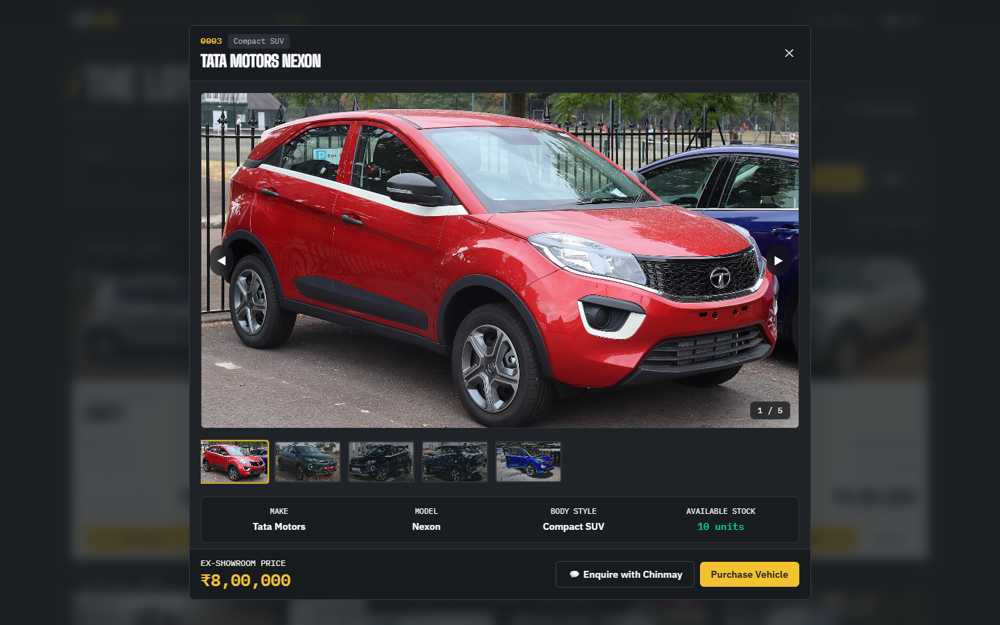
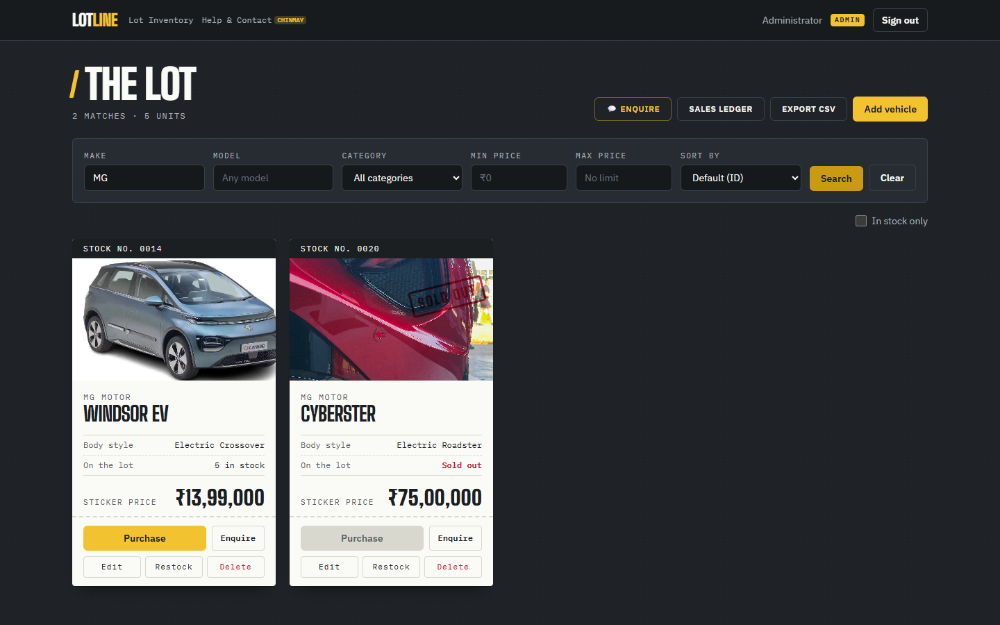
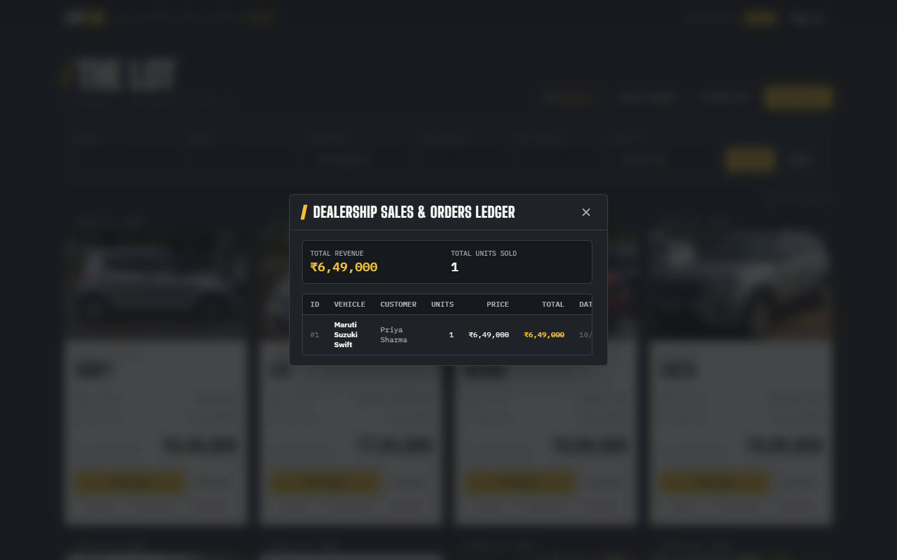

# Lotline: Car Dealership Inventory System

A full-stack inventory app for a car dealership, built test-first as the Incubyte **TDD Kata**.
Customers sign up, browse every vehicle on the lot, search by make, model, category or price, and buy what's in stock. Admins add, edit, restock and delete vehicles.

| | |
|---|---|
| **Backend** | Node.js 22, TypeScript, Express 5, SQLite (file-based via `better-sqlite3`), JWT, bcrypt, Zod |
| **Frontend** | React 19, TypeScript, Vite, Tailwind CSS v4, React Router |
| **Testing** | Vitest, Supertest, React Testing Library: **299 tests** (174 backend + 125 frontend), 99.7% backend line coverage |


---

## Contents

1. [Features](#features)
2. [Getting started](#getting-started)
3. [Docker deployment](#docker-deployment)
4. [API reference & Swagger](#api-reference)
5. [Architecture](#architecture)
6. [Testing & test report](#testing--test-report)
7. [Screenshots](#screenshots)
8. [Design decisions & assumptions](#design-decisions--assumptions)
9. [My AI Usage](#my-ai-usage)

---

## Features

**Everyone (after signing in)**
- Register and sign in. Sessions use a JWT, which is kept across page reloads and re-checked against the server on start-up.
- See every vehicle as a dealer **window sticker**: vehicle photo, stock number, make, model, body style, units on the lot and the sticker price formatted in **INR (`₹`)**.
- **Multi-Photo Gallery Modal**: Click any vehicle card to open the interactive photo gallery with 4–5 Wikimedia Commons photos per vehicle (credits and licences in [docs/IMAGE_CREDITS.csv](docs/IMAGE_CREDITS.csv)), thumbnail ribbon, keyboard navigation (`←`/`→`), and specs summary.
- **Direct Dealership Enquiry**: Click **"Enquire"** on any car or in the top navigation bar to open an enquiry form with call and WhatsApp links (the contact details are demo placeholders and the form isn't sent anywhere).
- **Help & Contact Page**: Dedicated `/help` page featuring Chinmay's profile, direct WhatsApp / call links, enquiry submission form, and Indian automotive purchase FAQs.
- Search by make or model (partial, case-insensitive), category, and min / max price.
- **Server-side Sorting**: Sort by price (low-to-high, high-to-low), make (A–Z), or newest arrival.
- Hide sold-out vehicles with **In stock only**.
- **Purchase** a vehicle. Stock updates instantly with atomic concurrency safety. Button is **disabled when quantity is zero** (shown with a "Sold out" stamp).
- **My Purchases**: View complete receipt history of all vehicles ordered, including date, quantity, and total price.

**Admins**
- Add a vehicle (with optional photo URL), edit its details, restock it, or delete it (with confirmation).
- As the brief specifies, `DELETE /api/vehicles/:id` and `POST /api/vehicles/:id/restock` are **admin-only on the server** (403 for everyone else). Adding and editing are open to any signed-in user in the API, but the UI only shows those forms to admins.
- **Dealership Sales Ledger**: Comprehensive sales audit log displaying total lot revenue, total units sold, and chronological customer order records.
- **Export CSV**: One-click download of the complete vehicle inventory ledger (`dealership_inventory.csv`).

**Robustness & Architecture**
- Stock can never go negative. A purchase is a single conditional `UPDATE … WHERE quantity >= ?`, so concurrent buyers can't oversell. Verified by concurrent multi-buyer stress tests.
- Every purchase transaction logs an immutable audit entry into the `orders` ledger.
- Every request is validated with Zod and returns field-level errors (`{ error, details: [{ field, message }] }`).
- Interactive OpenAPI 3.0 documentation with integrated **Swagger UI** on `/api/docs`.
- SQLite indexes on `price`, `category`, `make/model`, and order customer IDs for fast sub-millisecond query performance.

---

## Getting started

### Prerequisites
- **Node.js 20+** (developed on 22.20) and npm
- No database server is needed: SQLite stores everything in `backend/data/dealership.db`, which is created automatically.

### 1. Install

```bash
git clone <this-repo-url>
cd <repo-folder>
npm run install:all          # installs backend/ and frontend/
```

### 2. Configure the backend (optional)

```bash
cp backend/.env.example backend/.env
```

| Variable | Default | Purpose |
|---|---|---|
| `PORT` | `4000` | API port |
| `DATABASE_PATH` | `./data/dealership.db` | SQLite file |
| `JWT_SECRET` | dev-only value | **Required in production** (`NODE_ENV=production`) |
| `JWT_EXPIRES_IN` | `1d` | Token lifetime |
| `CORS_ORIGIN` | `http://localhost:5173` | Allowed frontend origin(s), comma-separated |
| `ADMIN_EMAIL` / `ADMIN_PASSWORD` | `admin@dealership.com` / `Admin@123` | Admin account created on start-up if missing |

### 3. Seed sample data (optional)

```bash
npm run seed                 # creates the admin and 20 Indian vehicles (if the lot is empty)
npm run seed:reset           # resets database and seeds all 20 Indian vehicles
```

### 4. Run

In two terminals:

```bash
npm run dev:backend          # API on http://localhost:4000
npm run dev:frontend         # App on http://localhost:5173 (proxies /api to the backend)
```

Open **http://localhost:5173**. Create an account for a customer view, or sign in as the admin (`admin@dealership.com` / `Admin@123` unless you changed it).

> **Admins:** registration always creates regular users (sending `"role": "admin"` is ignored). The admin account is created from `ADMIN_EMAIL` / `ADMIN_PASSWORD` when the server starts.

### Running each app on its own

```bash
# Backend
cd backend
npm run dev                  # watch mode
npm start                    # plain start
npm test                     # 174 tests
npm run test:coverage
npm run typecheck

# Frontend
cd frontend
npm run dev
npm test                     # 125 tests
npm run test:coverage
npm run build                # type-check + production build into dist/
npm run lint
```

### Docker deployment

The entire application can be built and run in isolated containers using Docker:

```bash
JWT_SECRET=<a-long-random-string> docker compose up --build
docker compose exec app npm run seed      # optional: sample inventory
```
This builds the frontend, then runs the API, which also serves the built app. Open `http://localhost:4000` for the app and `http://localhost:4000/api/docs` for Swagger. Data is kept in a named volume.

---

## API reference & Swagger

Interactive OpenAPI 3.0 documentation with live "Try It Out" test execution is available directly in the browser at:
👉 **`http://localhost:4000/api/docs`**

All responses are JSON. Errors follow the shape `{ "error": "message", "details"?: [{ "field": "price", "message": "…" }] }`.
Protected routes require `Authorization: Bearer <token>`.

| Method | Path | Auth | Description | Success |
|---|---|---|---|---|
| `POST` | `/api/auth/register` | – | `{ name, email, password (≥8) }` → `{ token, user }` | 201 |
| `POST` | `/api/auth/login` | – | `{ email, password }` → `{ token, user }` | 200 |
| `GET` | `/api/auth/me` | User | Current authenticated user | 200 |
| `GET` | `/api/vehicles` | User | All vehicles, including sold-out ones | 200 |
| `GET` | `/api/vehicles/search` | User | Query: `make`, `model`, `category`, `minPrice`, `maxPrice`, `sortBy` (`price_asc`, `price_desc`, `make_asc`, `newest`) | 200 |
| `GET` | `/api/vehicles/export/csv` | **Admin** | Export entire lot inventory to downloadable CSV file | 200 |
| `GET` | `/api/vehicles/:id` | User | Get single vehicle details | 200 |
| `POST` | `/api/vehicles` | User | Add vehicle `{ make, model, category, price, quantity?, imageUrl? }` | 201 |
| `PUT` | `/api/vehicles/:id` | User | Update `{ make, model, category, price, imageUrl? }` | 200 |
| `DELETE` | `/api/vehicles/:id` | **Admin** | Delete vehicle from lot | 204 |
| `POST` | `/api/vehicles/:id/purchase` | User | Purchase vehicle `{ quantity? }`. Concurrency safe; logs order to audit ledger | 200 |
| `POST` | `/api/vehicles/:id/restock` | **Admin** | Restock vehicle `{ quantity }` (int ≥1) | 200 |
| `GET` | `/api/orders/my` | User | Authenticated customer's personal purchase history | 200 |
| `GET` | `/api/orders` | **Admin** | Dealership sales ledger with aggregate revenue and chronological orders | 200 |
| `GET` | `/api/docs` | – | Interactive OpenAPI / Swagger UI | 200 |
| `GET` | `/api/health` | – | Health check `{ status: "ok" }` | 200 |

Status codes: `200`/`201` Success, `400` Validation error, `401` Unauthorized, `403` Forbidden (requires Admin role), `404` Not found, `409` Conflict (duplicate email or insufficient stock).

---

## Architecture

```
backend/src
├── server.ts              entry point: config → database → services → admin seed → listen
├── app.ts                 Express app factory (dependencies injected, so tests use their own DB)
├── container.ts           composition root: wires repositories into services
├── config.ts              typed, validated environment config
├── db/database.ts         SQLite connection + idempotent schema + index creation
├── models/                domain types (User, Vehicle, Order)
├── repositories/          persistence interfaces + SQLite implementations (UserRepository, VehicleRepository, OrderRepository)
├── services/              business rules (AuthService, VehicleService, OrderService), no Express coupling
├── validation/            Zod schemas + validate helpers → field-level 400s
├── middleware/            authenticate, requireRole, error handler
└── routes/                thin HTTP controllers (authRoutes, vehicleRoutes, orderRoutes, docsRoute)

frontend/src
├── api/                   fetch client (ApiError) + API functions (vehicles, orders, auth)
├── context/               AuthProvider + useAuth (JWT in localStorage, re-validated on load)
├── components/            VehicleCard, SearchFilters, VehicleForm, RestockForm, OrdersModal, VehicleGalleryModal, EnquiryModal, Modal, ConfirmDialog, Toast
├── pages/                 LoginPage, RegisterPage, DashboardPage, ContactHelpPage
├── data/                  car photo galleries, demo dealership contact
└── utils/format.ts        currency (INR ₹), stock-number formatting, error helpers
```

How the code follows SOLID:
- **Single responsibility:** routes only translate HTTP, services hold the business logic, repositories handle persistence.
- **Dependency inversion:** services depend on repository interfaces (`UserRepository`, `VehicleRepository`, `OrderRepository`), and `createApp` receives its services via a container.
- **Open/closed:** domain errors (`NotFoundError`, `ConflictError`, `ForbiddenError`) carry their HTTP status, allowing clean error propagation without changing error handling infrastructure.

---

## Testing & test report

The codebase was developed test-first following **Red → Green → Refactor**: each feature starts with failing tests, followed by implementation, and refactoring under a strict regression safety net.

```bash
npm test                     # runs both test suites
npm run test:coverage        # generates line & branch coverage
```

| Suite | Tests | Lines | Branches |
|---|---|---|---|
| Backend | 174 ✅ | 99.7% | 95.1% |
| Frontend | 125 ✅ | 93.8% | 88.9% |
| **Total** | **299 ✅** | | |

📄 The full report is in **[docs/TEST_REPORT.md](docs/TEST_REPORT.md)**.

---

## Screenshots

| Sign in | Register |
|---|---|
|  |  |

| Customer view | After a purchase |
|---|---|
|  |  |

| Search | Admin view |
|---|---|
|  |  |

| Add vehicle | Delete confirmation | Mobile |
|---|---|---|
|  |  |  |

| Photo gallery | Sold out: Purchase disabled |
|---|---|
|  |  |

| Sales ledger (admin) |
|---|
|  |

### Design

The UI is themed on the dealership lot itself: an **asphalt** background, **traffic-paint yellow** for parking-bay lines and primary actions, and each vehicle printed on an off-white **window sticker** (the Monroney label every new car carries) with a stock number, monospace spec rows and a big sticker price. Sold-out cars get a red rubber "Sold out" stamp. Type is Big Shoulders Display (dealership signage) with IBM Plex Sans and Plex Mono. The layout is responsive down to phone width, keyboard focus is always visible, dialogs close with Escape, and reduced-motion preferences are respected.

---

## Design decisions & assumptions

- **Who can change the catalogue.** The API follows the brief exactly: every vehicle route needs a login, and only `DELETE /api/vehicles/:id` and `POST /api/vehicles/:id/restock` also need the admin role (`requireRole('admin')`). The brief puts the add / edit / delete forms under "For Admin Users", so the UI shows them to admins only.
- **Stock only changes through purchase / restock.** `PUT` rejects `quantity`, so the admin-only restock rule can't be bypassed. The initial stock is set when a vehicle is created.
- **"All available vehicles"** returns every vehicle, sold-out ones included, so the UI can show them with a disabled Purchase button, as the spec requires. "In stock only" is a UI filter.
- **Search semantics.** Make and model match partially and case-insensitively. Category is an exact, case-insensitive match. The price range is inclusive, and filters combine with AND.
- **Purchase quantity.** Defaults to 1. An optional `{ quantity }` lets you buy several units at once.
- **Database.** SQLite in a file (persistent, zero setup). Tests use SQLite's `:memory:` mode for speed and isolation. The running app always uses the file.

---

## My AI Usage

### Tools used
- **Claude Code** (Anthropic, model Claude Opus 5.5), in the VS Code extension. Every commit made with it carries a `Co-Authored-By` trailer.

### How I used it
- **Initial build (2026-10-23).** I gave Claude Code the kata PDF and asked it to build the system test-first. It planned the layers, wrote the failing tests, made them pass and refactored, committing after each Red, Green and Refactor step. That is why the first 20 commits land within about half an hour of each other.
- **Understanding the code.** I asked it to explain the architecture and how to run the project, then read through the services, repositories and tests myself.
- **Feature additions (2026-10-24 to 25).** Purchase history and the sales ledger, the photo gallery, INR pricing and Indian models, sorting, CSV export, the help page, Docker and Swagger.
- **Review against the brief (2026-10-25).** I asked the AI to review the repo the way an Incubyte reviewer would. That found real problems, and I decided how to fix each one:
  - I had made `POST` and `PUT /api/vehicles` admin-only, which contradicts the brief. I put them back to "any signed-in user".
  - The new features had no tests, so frontend coverage had dropped to 71% while this README still claimed 97%. Tests were added, bringing it to 94%.
  - Docker couldn't start: `tsx` was missing at runtime, there was no `.dockerignore`, and the app wasn't served.
  - My real phone number and email were in a public repo.

**What I did by hand:** the AI-chosen vehicle photos often didn't match the make and model on the card, so I downloaded the right photos myself and replaced them (sources and licences are in [docs/IMAGE_CREDITS.csv](docs/IMAGE_CREDITS.csv)). I also ran the test suites myself after each change to check that everything still passed.

### Reflection

In this project I had to check everything, because AI is not always correct and I had to double-check its work. The upside was that I didn't have to write the CSS, HTML or design myself; I could use AI for that. I had to check for errors and make sure all test cases were passing. For instance, the vehicle photos didn't match the make and model of the car, so I had to download and replace them manually. This showed me that AI makes life easier by doing work that is similar and repetitive, but when you need to be more precise, you have to give your own input to make it unique.

The raw prompts are in [PROMPTS.md](PROMPTS.md).
