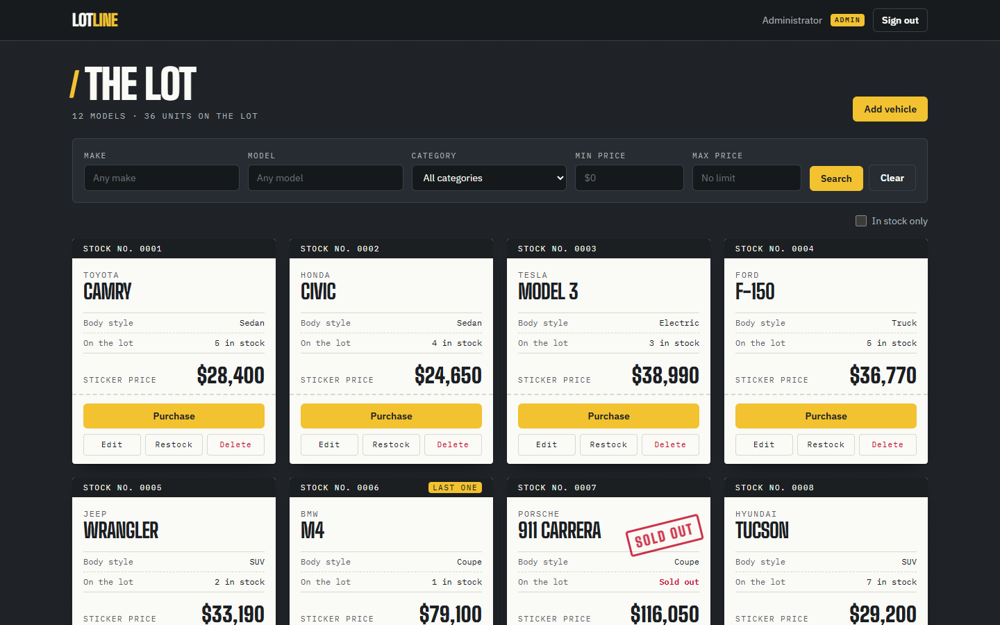
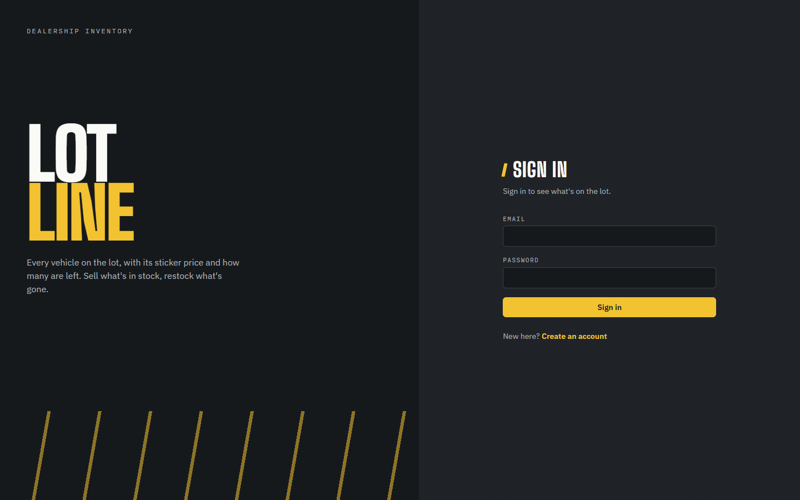
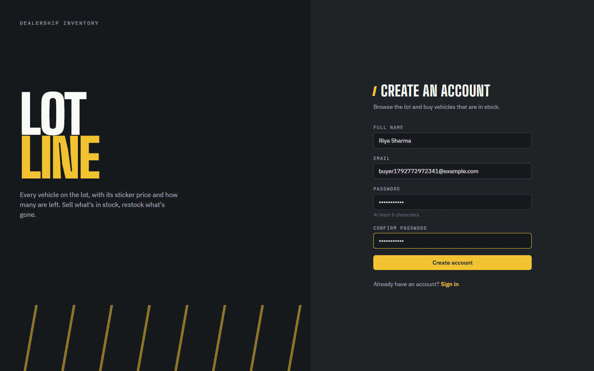
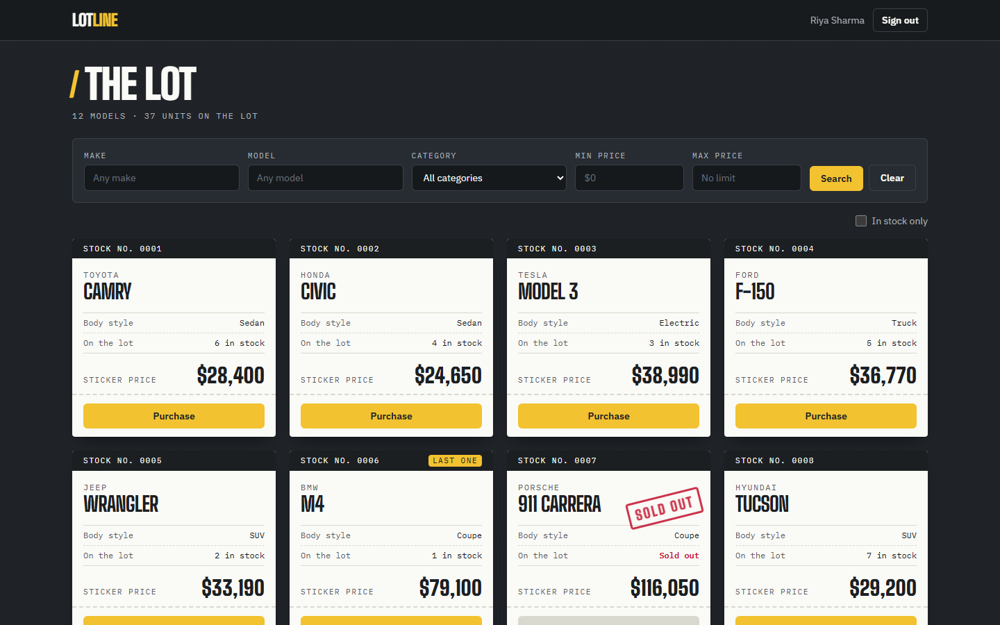
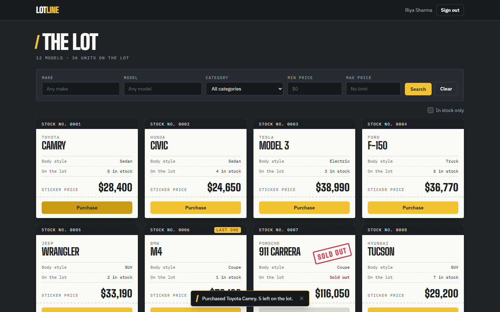
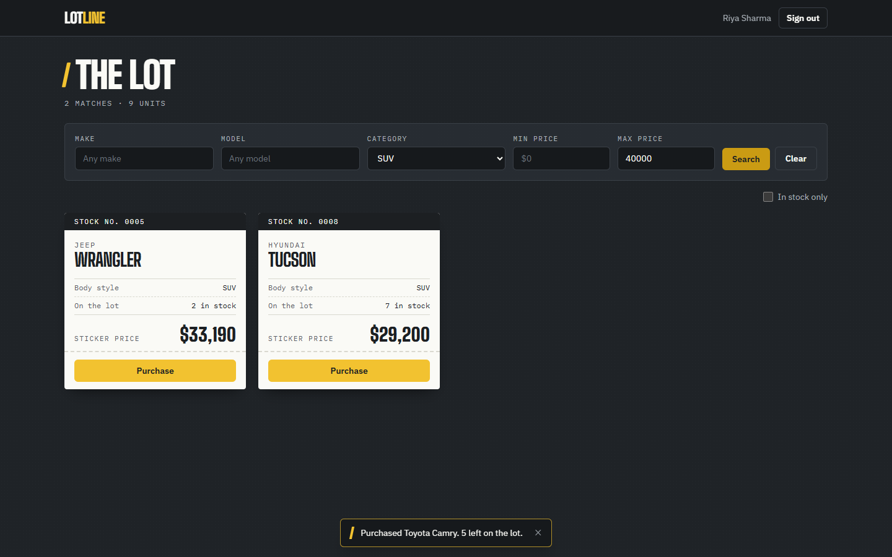
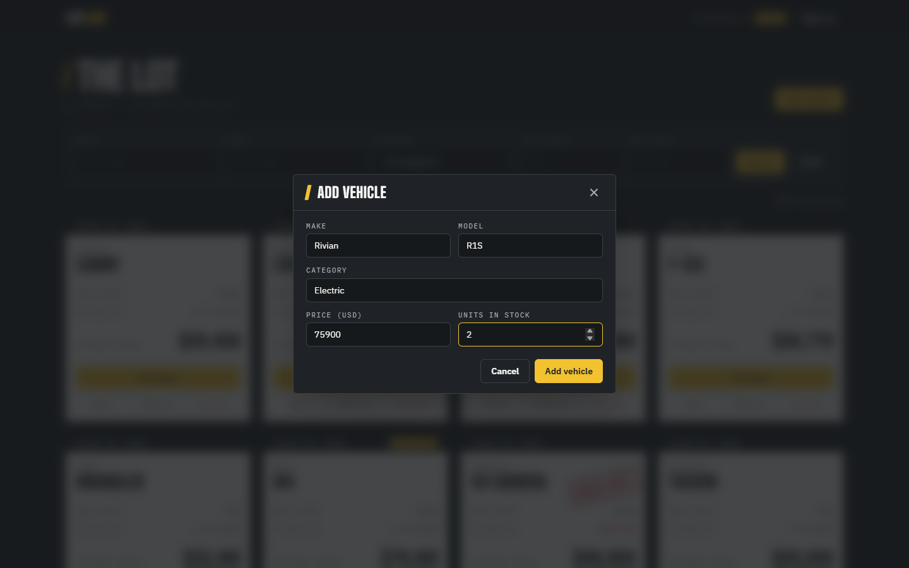
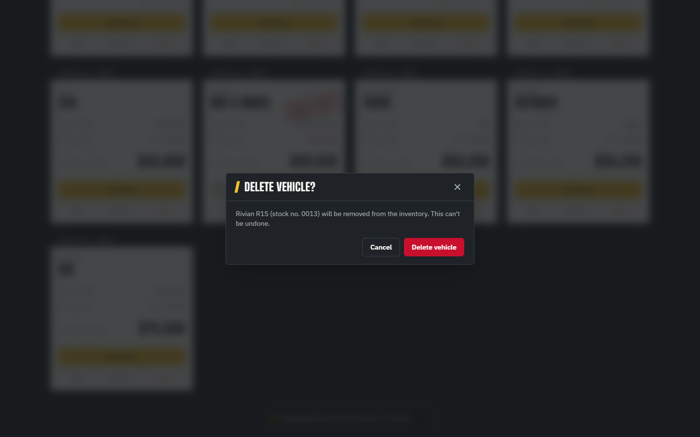
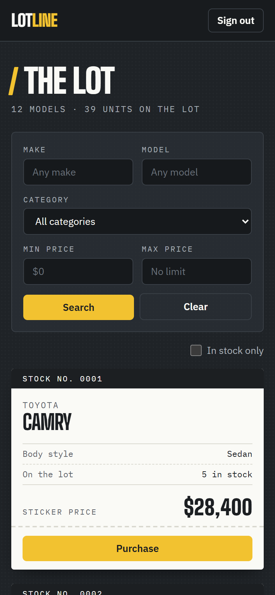

# Lotline: Car Dealership Inventory System

A full-stack inventory app for a car dealership, built test-first as the Incubyte **TDD Kata**.
Customers sign up, browse every vehicle on the lot, search by make, model, category or price, and buy what's in stock. Admins add, edit, restock and delete vehicles.

| | |
|---|---|
| **Backend** | Node.js 22, TypeScript, Express 5, SQLite (file-based via `better-sqlite3`), JWT, bcrypt, Zod |
| **Frontend** | React 19, TypeScript, Vite, Tailwind CSS v4, React Router |
| **Testing** | Vitest, Supertest, React Testing Library: **253 tests**, backend 100% line coverage, frontend 97% |



---

## Contents

1. [Features](#features)
2. [Getting started](#getting-started)
3. [API reference](#api-reference)
4. [Architecture](#architecture)
5. [Testing & test report](#testing--test-report)
6. [Screenshots](#screenshots)
7. [Design decisions & assumptions](#design-decisions--assumptions)
8. [My AI Usage](#my-ai-usage)

---

## Features

**Everyone (after signing in)**
- Register and sign in. Sessions use a JWT, which is kept across page reloads and re-checked against the server on start-up.
- See every vehicle as a dealer **window sticker**: stock number, make, model, body style, units on the lot and the sticker price.
- Search by make or model (partial, case-insensitive), category, and min / max price. Hide sold-out vehicles with **In stock only**.
- **Purchase** a vehicle. Stock updates instantly, and the button is **disabled when quantity is zero** (shown with a "Sold out" stamp).

**Admins**
- Add a vehicle, edit its details, restock it, or delete it (with confirmation).
- `DELETE /api/vehicles/:id` and `POST /api/vehicles/:id/restock` are enforced as **admin-only on the server** (403 for everyone else). The UI only shows these tools to admins.

**Robustness**
- Stock can never go negative. A purchase is a single conditional `UPDATE … WHERE quantity >= ?`, so concurrent buyers can't oversell. There is a test where 5 simultaneous buyers compete for 2 units.
- Every request is validated with Zod and returns field-level errors (`{ error, details: [{ field, message }] }`).
- Passwords are hashed with bcrypt. Login errors don't reveal whether an email exists. Roles are always read from the database, never trusted from the token.

---

## Getting started

### Prerequisites
- **Node.js 20+** (developed on 22.20) and npm
- No database server is needed: SQLite stores everything in `backend/data/dealership.db`, which is created automatically.

### 1. Install

```bash
git clone <this-repo-url>
cd <repo-folder>
npm run install:all          # installs backend/ and frontend/
```

### 2. Configure the backend (optional)

```bash
cp backend/.env.example backend/.env
```

| Variable | Default | Purpose |
|---|---|---|
| `PORT` | `4000` | API port |
| `DATABASE_PATH` | `./data/dealership.db` | SQLite file |
| `JWT_SECRET` | dev-only value | **Required in production** (`NODE_ENV=production`) |
| `JWT_EXPIRES_IN` | `1d` | Token lifetime |
| `CORS_ORIGIN` | `http://localhost:5173` | Allowed frontend origin(s), comma-separated |
| `ADMIN_EMAIL` / `ADMIN_PASSWORD` | `admin@dealership.com` / `Admin@123` | Admin account created on start-up if missing |

### 3. Seed sample data (optional)

```bash
npm run seed                 # creates the admin and 12 sample vehicles (only if the lot is empty)
```

### 4. Run

In two terminals:

```bash
npm run dev:backend          # API on http://localhost:4000
npm run dev:frontend         # App on http://localhost:5173 (proxies /api to the backend)
```

Open **http://localhost:5173**. Create an account for a customer view, or sign in as the admin (`admin@dealership.com` / `Admin@123` unless you changed it).

> **Admins:** registration always creates regular users (sending `"role": "admin"` is ignored). The admin account is created from `ADMIN_EMAIL` / `ADMIN_PASSWORD` when the server starts.

### Running each app on its own

```bash
# Backend
cd backend
npm run dev                  # watch mode
npm start                    # plain start
npm test                     # 158 tests
npm run test:coverage
npm run typecheck

# Frontend
cd frontend
npm run dev
npm test                     # 95 tests
npm run test:coverage
npm run build                # type-check + production build into dist/
npm run lint
```

### Production build of the frontend

Set `VITE_API_URL` to the API's origin at build time (for example `VITE_API_URL=https://api.example.com npm run build`) and add the frontend's origin to the backend's `CORS_ORIGIN`.

---

## API reference

All responses are JSON. Errors look like `{ "error": "message", "details"?: [{ "field": "price", "message": "…" }] }`.
Protected routes need `Authorization: Bearer <token>`.

| Method | Path | Auth | Description | Success |
|---|---|---|---|---|
| `POST` | `/api/auth/register` | – | `{ name, email, password (≥8) }` → `{ token, user }` | 201 |
| `POST` | `/api/auth/login` | – | `{ email, password }` → `{ token, user }` | 200 |
| `GET` | `/api/auth/me` | User | Current user | 200 |
| `POST` | `/api/vehicles` | User | Add `{ make, model, category, price (>0, ≤2 decimals), quantity? (int ≥0, default 0) }` | 201 |
| `GET` | `/api/vehicles` | User | All vehicles, including sold-out ones | 200 |
| `GET` | `/api/vehicles/search` | User | Query: `make`, `model` (partial), `category` (exact), `minPrice`, `maxPrice` (inclusive) | 200 |
| `GET` | `/api/vehicles/:id` | User | One vehicle | 200 |
| `PUT` | `/api/vehicles/:id` | User | Update any of `make, model, category, price` | 200 |
| `DELETE` | `/api/vehicles/:id` | **Admin** | Delete | 204 |
| `POST` | `/api/vehicles/:id/purchase` | User | Body optional `{ quantity }` (default 1). 409 if there isn't enough stock | 200 |
| `POST` | `/api/vehicles/:id/restock` | **Admin** | `{ quantity }` (int ≥1) | 200 |
| `GET` | `/api/health` | – | `{ status: "ok" }` | 200 |

Status codes used: `400` validation / malformed JSON, `401` missing or invalid token, `403` not an admin, `404` unknown vehicle or route, `409` duplicate email or not enough stock, `413` body too large.

Vehicle shape:

```json
{ "id": 1, "make": "Toyota", "model": "Camry", "category": "Sedan", "price": 28400, "quantity": 6,
  "createdAt": "2026-10-23T16:12:03.691Z", "updatedAt": "2026-10-23T16:12:03.691Z" }
```

---

## Architecture

```
backend/src
├── server.ts              entry point: config → database → services → admin seed → listen
├── app.ts                 Express app factory (dependencies injected, so tests use their own DB)
├── container.ts           composition root: wires repositories into services
├── config.ts              typed, validated environment config
├── db/database.ts         SQLite connection + idempotent schema (CHECK constraints)
├── models/                domain types (User, Vehicle)
├── repositories/          persistence interfaces + SQLite implementations
├── services/              business rules (AuthService, VehicleService), no Express code here
├── validation/            Zod schemas + validate helpers → field-level 400s
├── middleware/            authenticate, requireRole, error handler
└── routes/                thin HTTP controllers

frontend/src
├── api/                   fetch client (ApiError) + one function per endpoint
├── context/               AuthProvider + useAuth (JWT in localStorage, re-validated on load)
├── components/            VehicleCard, SearchFilters, VehicleForm, RestockForm, Modal, ConfirmDialog, Toast, route guards, layouts
├── pages/                 LoginPage, RegisterPage, DashboardPage
└── utils/format.ts        price / stock-number formatting, error helpers
```

How the code follows SOLID:
- **Single responsibility:** routes only translate HTTP, services hold the rules, repositories only do SQL.
- **Dependency inversion:** services depend on the `UserRepository` / `VehicleRepository` interfaces, and `createApp` receives its services. That's what lets every test build an isolated app on its own database.
- **Open/closed:** domain errors (`NotFoundError`, `ConflictError`, …) carry their HTTP status, so a new error type needs no changes to the error handler.

---

## Testing & test report

The work followed **Red → Green → Refactor**, and the commit history shows it: each feature starts with a `test: … (RED)` commit of failing tests, followed by a `feat: … (GREEN)` commit, with `refactor:` commits where code was cleaned up under passing tests.

```bash
npm test                     # both suites, from the repo root
npm run test:coverage        # with coverage tables
```

| Suite | Tests | Lines | Branches |
|---|---|---|---|
| Backend | 158 ✅ | 100% | 96.9% |
| Frontend | 95 ✅ | 97.4% | 95.2% |

📄 The full report, including what each test file covers and an end-to-end browser run, is in **[docs/TEST_REPORT.md](docs/TEST_REPORT.md)**. Raw output: [backend](docs/backend-test-output.txt), [frontend](docs/frontend-test-output.txt).

---

## Screenshots

| Sign in | Register |
|---|---|
|  |  |

| Customer view | After a purchase |
|---|---|
|  |  |

| Search: SUVs up to $40,000 | Admin view |
|---|---|
|  |  |

| Add vehicle | Delete confirmation | Mobile |
|---|---|---|
|  |  |  |

### Design

The UI is themed on the dealership lot itself: an **asphalt** background, **traffic-paint yellow** for parking-bay lines and primary actions, and each vehicle printed on an off-white **window sticker** (the Monroney label every new car carries) with a stock number, monospace spec rows and a big sticker price. Sold-out cars get a red rubber "Sold out" stamp. Type is Big Shoulders Display (dealership signage) with IBM Plex Sans and Plex Mono. The layout is responsive down to phone width, keyboard focus is always visible, dialogs close with Escape, and reduced-motion preferences are respected.

---

## Design decisions & assumptions

- **Who can add / update vehicles.** The kata marks only *delete* and *restock* as "Admin only", so on the API `POST` and `PUT /api/vehicles` require a signed-in user, exactly as specified. The frontend shows the add / edit forms only to admins, as the spec's frontend section asks. If these should be admin-only on the server too, it's a one-line change per route in `vehicleRoutes.ts` (add `adminOnly`).
- **Stock only changes through purchase / restock.** `PUT` rejects `quantity`, so the admin-only restock rule can't be bypassed. The initial stock is set when a vehicle is created.
- **"All available vehicles"** returns every vehicle, sold-out ones included, so the UI can show them with a disabled Purchase button, as the spec requires. "In stock only" is a UI filter.
- **Search semantics.** Make and model match partially and case-insensitively. Category is an exact, case-insensitive match. The price range is inclusive, and filters combine with AND.
- **Purchase quantity.** Defaults to 1. An optional `{ quantity }` lets you buy several units at once.
- **Database.** SQLite in a file (persistent, zero setup). Tests use SQLite's `:memory:` mode for speed and isolation. The running app always uses the file.

---

## My AI Usage

> ✏️ *Draft. Please review and rewrite this section in your own words before submitting: the reflection should be yours.*

**Tools used**
- **Claude Code** (Anthropic, model Claude Opus 5.5), used as a pair-programmer in the VS Code extension.

**How I used it**
- I gave Claude Code the kata PDF and asked it to plan and build the project test-first. It proposed the stack (Express + SQLite, React + Vite + Tailwind) and the layered architecture, which I reviewed.
- It wrote the failing tests for each slice first (repositories → services → HTTP API → frontend data layer → components → pages), ran them to confirm they failed, then wrote the implementation to make them pass, committing each RED / GREEN / REFACTOR step separately.
- It suggested edge cases I then checked, such as concurrent purchases overselling, forged JWT role claims, LIKE-wildcard injection in search, and race conditions on duplicate registration.
- It ran an end-to-end check in a headless browser against the real API and captured the screenshots in this README.
- It drafted this README and the test report.

Every commit made with AI assistance carries a `Co-Authored-By: Claude Opus 5.5 <noreply@anthropic.com>` trailer.

**Reflection**
- *(Write your own: for example, what sped up, what you had to check or correct, what you learned about TDD by watching tests fail first, and where you'd still rely on your own judgement.)*

The raw AI chat log is in [PROMPTS.md](PROMPTS.md).
